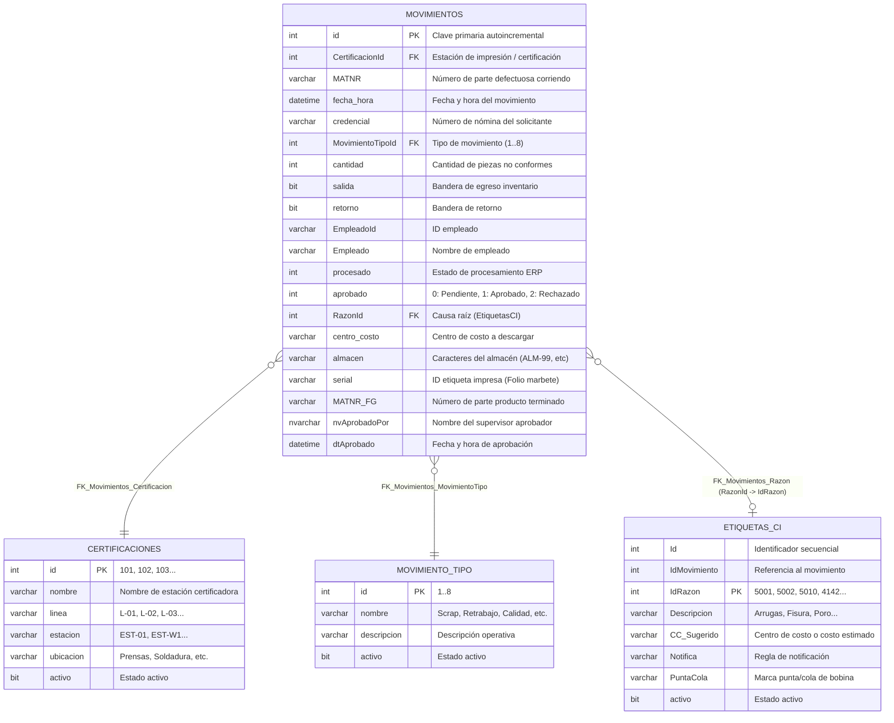

# Diagrama Entidad-Relación (ER): Base de Datos SSMS

### Relaciones Clave:
1. **`dbo.Movimientos` -> `dbo.Certificaciones`**: Cada movimiento queda sellado en la estación o celda donde se emite la etiqueta física (`CertificacionId`).
2. **`dbo.Movimientos` -> `dbo.MovimientoTipo`**: Cada transacción se tipifica numéricamente (1: Scrap, 2: Retrabajo en Línea, 3: Calidad, etc.).
3. **`dbo.Movimientos` -> `dbo.EtiquetasCI`**: Se vincula el código de falla automotriz mediante `RazonId` hacia `IdRazon` (5001 = Arrugas, 5010 = Fisura, etc.).
