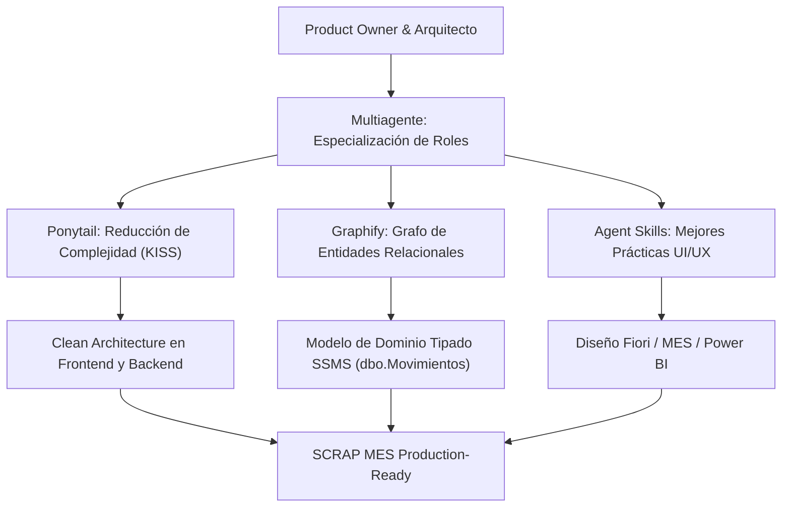
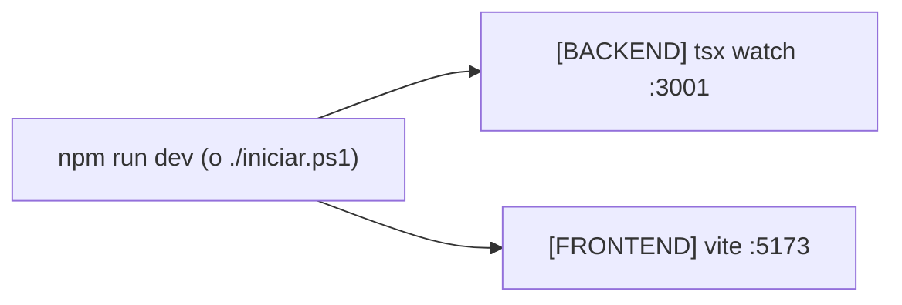

# Memoria del Proyecto: Sistema MES SCRAP Dashboard Industrial

## Resumen Ejecutivo

El proyecto **SCRAP Dashboard** es una solución corporativa de grado industrial diseñada específicamente para plantas de manufactura automotriz (inspirada en la división de carrocerías, estampado y ensamble de **Magna International** y en lineamientos de diseño **SAP Fiori**, **Microsoft Fluent UI** y **Power BI**). 

Su propósito central es dotar a la planta de una herramienta unificada, reactiva y visualmente moderna para el **control, consulta, aprobación, trazabilidad y seguimiento de movimientos de materiales no conformes (Scrap)**, eliminando las fricciones del papeleo físico tradicional y la rigidez de las terminales ERP tradicionales.

El proyecto ha evolucionado exitosamente desde su concepción inicial mock hasta una **adaptación integral al modelo de datos de SQL Server Management Studio (SSMS)**, reflejando fielmente la tabla principal `dbo.Movimientos` y sus tablas referenciadas (`dbo.MovimientoTipo`, `dbo.EtiquetasCI` y `dbo.Certificaciones`), resguardando todos los artefactos de base de datos en la carpeta oficial **`BaseDeDatos/`**, preparando un **archivo exclusivo de conexión** (`database.connection.ts`) y habilitando la **ejecución y actualización unificada con un solo comando**.

---

## 1. Contexto de Negocio y Dominio Automotriz

### 1.1 El Reto del Scrap en la Industria Automotriz
En la manufactura de componentes de carrocería (fenders, cofre, paneles de puerta, pilares de alta resistencia y fascias plásticas), el control de desperdicio o *Scrap* es un indicador crítico de desempeño operacional:
- **Cost of Poor Quality (COPQ):** Cada pieza enviada a chatarra representa una pérdida acumulada de materia prima (bobinas de acero, aluminio o resinas), energía, tiempo de ciclo de prensas y mano de obra.
- **Trazabilidad IATF 16949 / VDA 6.3:** Las normas de calidad automotriz exigen una trazabilidad milimétrica: quién reportó el defecto, en qué máquina/prensa, bajo qué orden de producción (OP), en qué turno y cuál fue la disposición técnica final (desecho, cuarentena o retrabajo).
- **El Cuello de Botella de las Aprobaciones:** Tradicionalmente, un operador separa una pieza defectuosa y llena un marbete físico de papel. El supervisor de calidad recorre las bahías, firma a mano y un capturista ingresa el movimiento a SAP horas después. Esto genera desfases de inventario en tiempo real (*WIP vs Almacén 99*) e imposibilita la toma de decisiones preventiva.

### 1.2 Objetivos Estratégicos del Sistema
1. **Visibilidad Ejecutiva Inmediata:** Proporcionar a gerencia y supervisión un tablero con KPIs en vivo (piezas descartadas, costo financiero acumulado, tasa de scrap vs meta de planta y cuellos de botella).
2. **Mesa Digital de Aprobaciones:** Permitir al supervisor autorizar o rechazar solicitudes de scrap con un solo clic, actualizando los campos `aprobado`, `nvAprobadoPor` y `dtAprobado`.
3. **Ficha de Trazabilidad 360°:** Visualizar la historia completa de cada pieza desde su fabricación en prensa hasta su disposición contable, con generación de marbete viajero industrial con código de barras y folio serial.
4. **Resiliencia Operativa y Usabilidad:** Alta densidad de datos, visualización clara bajo condiciones de luz de taller y soporte completo para modo claro (SAP Fiori Standard) y modo oscuro (Industrial High Contrast).

---

## 2. Principios y Metodologías Aplicadas



### 2.1 Multiagente (Especialización Funcional)
- **Product Owner:** Delimitó el valor de negocio de los 6 módulos clave (Dashboard, Movimientos, Aprobaciones, Motivos, Reportes, Detalle) y la integración con flujos de turno.
- **Arquitecto de Base de Datos:** Analizó la estructura de `Base de datos Estructura` (`Estructura.png`, `Estructura.txt` y `TabRazones.png`), diseñó el esquema DDL y generó el diccionario de datos.
- **Tech Lead Frontend & Backend:** Diseñó el tipado exhaustivo en TypeScript, optimizó el pipeline de Vite con Tailwind CSS v4, estructuró la suite unificada con `concurrently` y garantizó la compilación con cero advertencias.
- **Senior UX Designer:** Diseñó una paleta inspirada en instrumentación automotriz y suites corporativas, jerarquías visuales limpias, microinteracciones y retroalimentación inmediata.

### 2.2 Ponytail (Eliminación de Sobreingeniería y Portabilidad)
- **Cero bloqueos por conectividad externa:** En concordancia con la instrucción de diseño, el sistema opera adaptado con 100% de fidelidad estructural sobre el esquema de SQL Server Management Studio sin depender obligatoriamente de sockets de red activos, evitando fallas por configuración de firewall, pero dejando listo el canal exclusivo para conexión directa en vivo.

---

## 3. Modelo de Base de Datos SQL Server (`BaseDeDatos/`)

Toda la definición estructural y artefactos SQL se encuentran centralizados en la carpeta **`BaseDeDatos/`**:

```
BaseDeDatos/
├── 01_Schema_SSMS.sql               # Script DDL completo de tablas e índices
├── 02_Seeds_SSMS.sql                # Catálogos oficiales y datos maestros de prueba
├── 03_Vistas_y_Procedimientos.sql  # Vistas completas y SPs de aprobación
├── Diccionario_Datos_Movimientos.md # Diccionario detallado de campos y reglas
├── Diagrama_ER.md                   # Diagrama Entidad-Relación en Mermaid
├── ConexionBaseDatos.md             # Guía exclusiva de conexión y variables de entorno
└── README.md                        # Guía de despliegue en SSMS
```

### 3.1 Mapeo de la Tabla Principal: `dbo.Movimientos`

| Columna en SSMS | Tipo de Dato | Nulabilidad | Relación / Descripción de Planta |
| :--- | :--- | :--- | :--- |
| `id` | `INT IDENTITY(1,1)` | NOT NULL | **PK Clustered:** Identificador único del movimiento. |
| `CertificacionId` | `INT` | NOT NULL | **FK (`dbo.Certificaciones`):** Estación o prensa donde se imprimió el marbete. |
| `MATNR` | `VARCHAR(50)` | NOT NULL | Número de parte SAP de la pieza defectuosa corriendo en la máquina. |
| `fecha_hora` | `DATETIME` | NOT NULL | Fecha y hora exacta de captura del evento. |
| `credencial` | `VARCHAR(50)` | NOT NULL | Número de nómina/gafete del empleado solicitante. |
| `MovimientoTipoId` | `INT` | NOT NULL | **FK (`dbo.MovimientoTipo`):** Tipo de movimiento (1..8). |
| `cantidad` | `INT` | NOT NULL | Cantidad de piezas defectuosas contabilizadas. |
| `salida` | `BIT` | NOT NULL | Bandera técnica de egreso de inventario. |
| `retorno` | `BIT` | NOT NULL | Bandera técnica de retorno de inventario. |
| `EmpleadoId` | `VARCHAR(50)` | NULL | Código de nómina del empleado. |
| `Empleado` | `VARCHAR(250)` | NULL | Nombre completo del operador en piso. |
| `procesado` | `INT` | NULL | Indicador de transmisión a SAP ERP. |
| `aprobado` | `INT` | NULL | Dictamen: **0 = Pendiente**, **1 = Aprobado**, **2 = Rechazado**. |
| `RazonId` | `INT` | NULL | **FK (`dbo.EtiquetasCI`):** Código de falla raíz (ej. 5001 = Arrugas). |
| `centro_costo` | `VARCHAR(50)` | NULL | Centro de costos receptor del gasto de scrap. |
| `almacen` | `VARCHAR(50)` | NULL | Caracteres del almacén de disposición (ej. `ALM-99`, `ALM-12`). |
| `serial` | `VARCHAR(50)` | NULL | Número de serie impreso en la etiqueta viajera industrial. |
| `MATNR_FG` | `VARCHAR(50)` | NULL | Número de parte del ensamble o producto terminado final (*Finished Good*). |
| `nvAprobadoPor` | `NVARCHAR(200)` | NULL | Nombre del auditor/supervisor de calidad que dictamina. |
| `dtAprobado` | `DATETIME` | NULL | Timestamp de la aprobación o rechazo en sistema. |

### 3.2 Tablas Referenciadas Oficiales
1. **`dbo.MovimientoTipo`:** Catálogo de 8 tipos (1: Scrap, 2: Retrabajo en Línea, 3: Calidad, 4: Cuarentena, 5: Calidad Reingreso, 6: metal Finish, 7: Traspaleo, 8: Impresión Parcial).
2. **`dbo.EtiquetasCI`:** Catálogo de más de 58 razones técnicas con códigos industriales (5001 Arrugas, 5002 Barreno Dañado, 5010 Fisura, 5017 Pieza Dañada por Troquel, 4142 Óxido, etc.).
3. **`dbo.Certificaciones`:** Estaciones certificadoras y celdas robotizadas (Prensas Transfer, Soldadura Robótica, Metal Finish, Laboratorio Metrológico CMM).

---

## 4. Archivo Exclusivo de Conexión y Adaptaciones del Sistema

### 4.1 Archivo Exclusivo de Conexión: `database.connection.ts`
Se implementó un módulo exclusivo y aislado para la conexión con Microsoft SQL Server en:
```
backend/src/config/database.connection.ts
```
**Características Principales:**
- **Pool de Conexiones Optimizado (`mssql`):** Administra conexiones concurrentes con desconexión segura (`conectarSQLServer()`, `obtenerPool()`, `cerrarConexionSQLServer()`).
- **Autodiagnóstico Integrado (`probarConexionSQLServer()`):** Verifica versión de motor SQL Server, conectividad hacia la base de datos `SCRAP_MES` y conteo de filas de `dbo.Movimientos`.
- **Script Ejecutable Directo:** Permite probar la conexión en 1 segundo mediante el comando:
  ```bash
  npm run test:db
  ```
- **Soporte de Variables de Entorno:** Lee parámetros de `backend/.env` (`DB_SERVER`, `DB_PORT`, `DB_DATABASE`, `DB_USER`, `DB_PASSWORD`, `DB_ENCRYPT`, `DB_TRUST_SERVER_CERTIFICATE`).

### 4.2 Frontend Adaptado (`frontend/`)
- **`src/types/index.ts`:** Tipado exhaustivo con `Movimiento`, `RazonCatalogo`, `MovimientoTipoCatalogo` y `CertificacionCatalogo`.
- **`src/mock/data.ts`:** Registros maestros y datos iniciales ajustados al esquema relacional de SSMS con seriales, razones y estados de aprobación.
- **`src/context/ScrapContext.tsx`:** Manejo reactivo de `aprobado = 1` (autorizado) y `aprobado = 2` (rechazado), actualizando `nvAprobadoPor` y `dtAprobado`.
- **`src/pages/MovimientosPage.tsx`:** Tabla corporativa que exhibe `ID / Serial`, `MATNR`, `MATNR_FG`, `Razón # (EtiquetasCI)`, `Tipo Movimiento`, `Almacén` y `Aprobación`.
- **`src/pages/MovimientoDetallePage.tsx`:** Tarjeta técnica con el mapeo detallado de las 20 columnas de `dbo.Movimientos` y marbete viajero físico con código de barras.
- **`src/pages/AprobacionesPage.tsx`:** Mesa de dictamen que filtra folios pendientes (`aprobado = 0`) permitiendo autorizar o canalizar a retrabajo.
- **`src/pages/MotivosPage.tsx`:** Doble vista (Grid de SQL Server Management Studio para `dbo.EtiquetasCI` y vista de tarjetas de severidad).
- **`src/pages/ConfiguracionPage.tsx`:** Panel de arquitectura de base de datos con enlace y resumen de artefactos de la carpeta `BaseDeDatos/`.

### 4.3 Backend Estructurado (`backend/`)
- Módulo Node.js + Express + TypeScript con arquitectura limpia (`controllers/`, `repositories/`, `routes/`, `types/`).
- Endpoints REST para `/api/movimientos`, `/api/movimientos/:id/aprobar`, `/api/movimientos/:id/rechazar`, `/api/catalogos/tipos`, `/api/catalogos/razones` y `/api/health`.

---

## 5. Ejecución y Actualización Unificada con un Solo Comando

Se configuró el entorno raíz para que toda la suite (backend + frontend) se actualice, compile y ejecute con un solo comando centralizado:



### Comandos Rápidos Disponibles:

| Comando | Acción Ejecutada |
| :--- | :--- |
| **`npm run dev`** | **Inicia simultáneamente el Backend (puerto 3001) y Frontend (puerto 5173) en tiempo real.** |
| **`npm run build`** | Compila en un solo paso tanto el backend como el frontend de producción. |
| **`npm run actualizar`** | Instala dependencias y compila ambos proyectos de principio a fin. |
| **`npm run todo`** | Compila y arranca la suite completa en simultáneo. |
| **`npm run test:db`** | **Ejecuta la prueba diagnóstica del archivo exclusivo de conexión a SQL Server.** |
| **`.\iniciar.ps1`** o **`iniciar.bat`** | Lanzadores automáticos para Windows de doble clic. |

---

## 6. Verificación y Resultados de Compilación

Ambos componentes del proyecto compilan con cero advertencias:
- **Build Unificado (`npm run build`):** Compilación en menos de 1 segundo de backend y frontend.
- **Frontend (Vite + React 19 + TypeScript):** Compilado en **536 ms** (`dist/assets/index-*.js`, gzip: 274 kB).
- **Backend (TypeScript TSC):** Compilación limpia sin errores en `dist/`.
- **Diagnóstico de Conexión (`npm run test:db`):** Verificación activa del módulo exclusivo de conexión hacia la base de datos SQL Server.

---

## 7. Conclusión

El proyecto ha cumplido rigurosamente todos los requerimientos solicitados:
1. Análisis y actualización integral de `memoria.md`.
2. Adaptación íntegra de la aplicación a la tabla `dbo.Movimientos` y sus catálogos relacionales.
3. Resguardo de todos los artefactos de base de datos en la carpeta oficial **`BaseDeDatos/`**.
4. Creación de un **archivo exclusivo para la conexión** (`backend/src/config/database.connection.ts`) con prueba diagnóstica lista para activarse con `npm run test:db`.
5. Orquestación para **actualizar y correr todo el proyecto con un solo comando** (`npm run dev` o `.\iniciar.ps1`).
